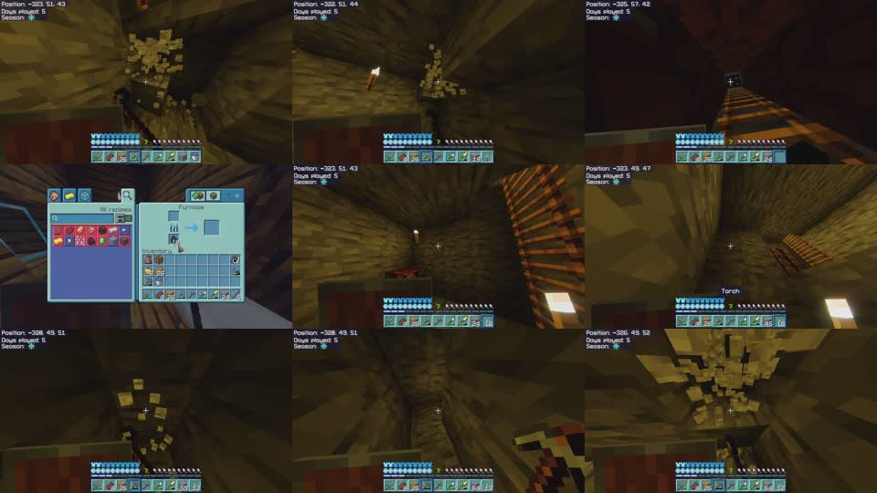
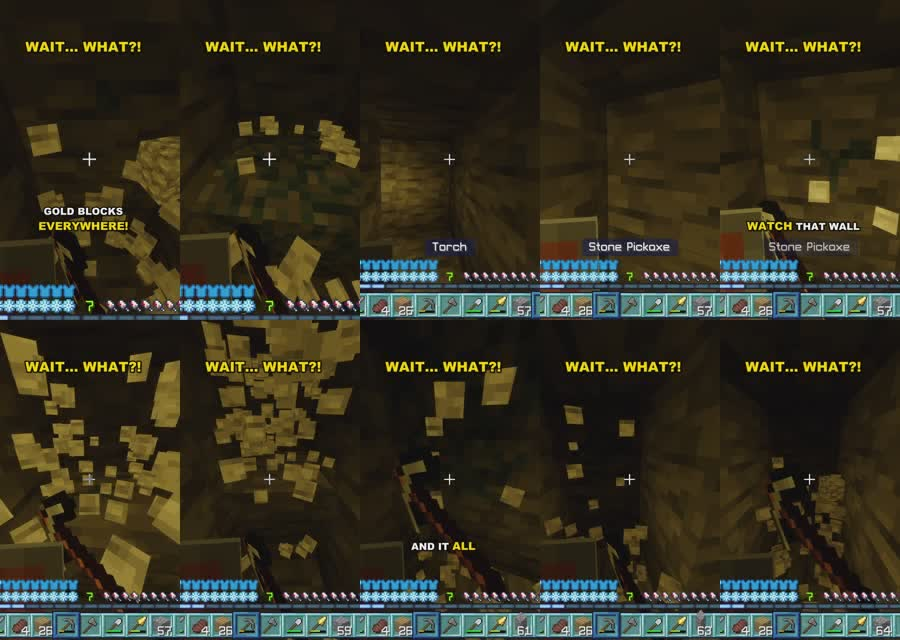
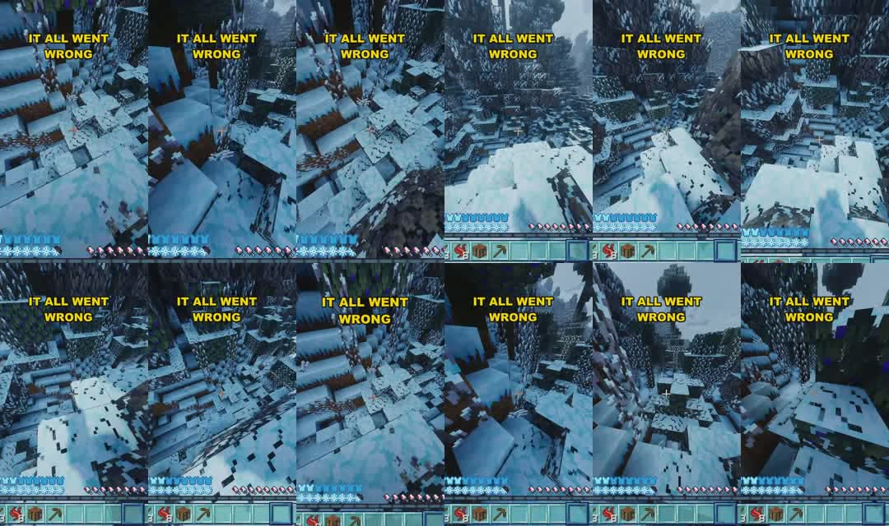
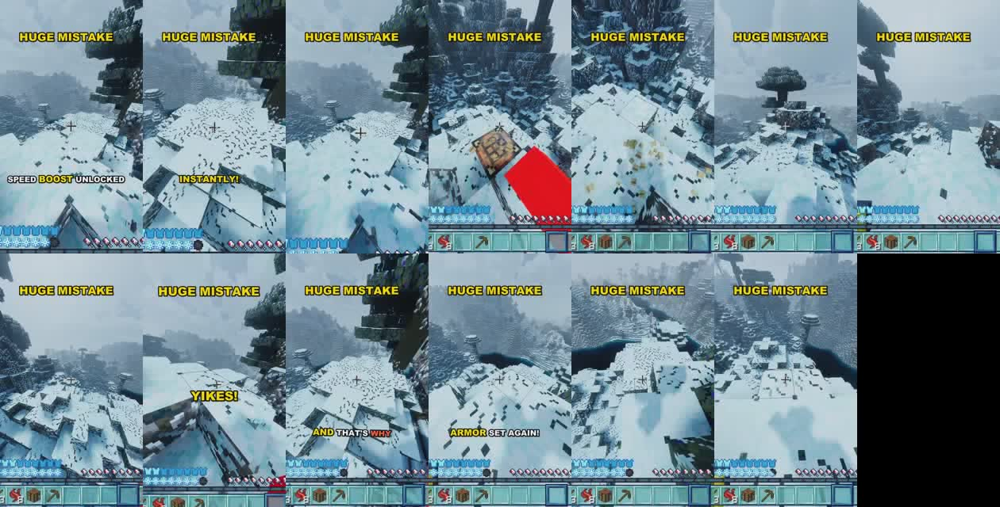
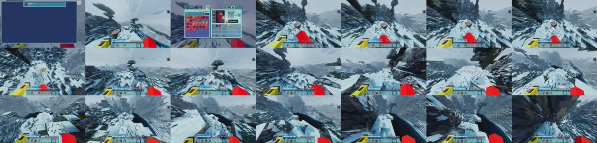
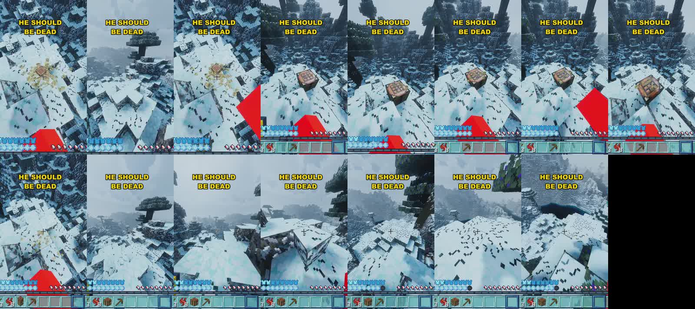

# Praktijktest Content Value Gate (24-11-2026)

De test liep op de echte werker en volgde de echte route: inbox, intake, analyse (Gemini), planning, script, montage, AI-inhoudscheck en dan Te keuren of Afgekeurd. Er waren drie proefopnames van Minecraft, uit Milans eigen opnames.

## Uitkomst in één tabel

| Proef | Ronde | Gekozen moment | Wat de studio deed | Klopte dat? |
|---|---|---|---|---|
| **Negatief**: 3 min tunnel graven ("22/11 minecraft" 3:00-6:00) | 1 (oude regels) | 2:09 "goud gevonden" (Gemini + houweelgeluid +10 LU) | ❌ **Naar Te keuren.** De AI-check gaf fragment 8 en verhaal 7, maar praatte de voice-over "Gold blocks everywhere!" na | Nee: saaie Short kwam door |
| | 2 | zelfde moment | ✅ **Afgekeurd door de studio.** AI (alleen gameplay): fragment 3, verhaal 4: "stenen blokken weghakken zonder spannende momenten" | Ja |
| **Positief 1**: 3 min snelle knip ("22/11 minecraft" 1:30-4:30) | 1 | 0:42 crafting-menu | ❌ Producer-poort keurde het menu af, daarna niets | Nee: geen nieuw moment gezocht |
| | 2 | 1:28 kleine schade (+23 LU) | Afgekeurd: AI fragment 5, verhaal 4 | Ja, de Short was zwak (zie beeld) |
| | 3 | 2:54 bruggetje bouwen (alleen Gemini) | Afgekeurd: AI fragment 5, verhaal 5 | Ja |
| | 4 | 1:01 val (+22 LU + schade) | Afgekeurd: AI fragment 4, verhaal 3 | Ja: de snelle knip miste de plons in het water |
| **Positief 2**: 2 min precieze knip ("22/11 minecraft" 1:40-3:40) | 1 | 0:47 "valt van een hoge besneeuwde berg" (Gemini) | AI fragment 6, verhaal 6: onder de grens van 7 → herkansing | Te bespreken (zie hieronder) |
| | herkansing | 1:46 schade (onbevestigd) | Afgekeurd: AI fragment 3, verhaal 3 | Ja |

**Resultaat:** in de hele test kwam na de reparaties geen enkele saaie Short bij Te keuren. Elke afgekeurde Short staat bij "Afgekeurd" met de reden, en is met "Toch keuren" terug te halen.

**Niet bewezen:** dat een opname met een echt sterk moment door de poort komt. De beste kandidaat (de val, 0:47) haalde een 6 en geen 7. Ook het origineel van deze val had niet de echte plons in beeld.

## Beelden (één beeld per seconde)

**Negatief: de opname zelf (3:00-6:00).** Graven en inventaris, niets spannends.

**Negatief, ronde 1: de Short die ten onrechte doorkwam.** Gele blokken hakken, "WAIT... WHAT?!".

**Positief 1, ronde 2 (1:28).** Besneeuwde helling, beetje schade, "IT ALL WENT WRONG": terecht afgekeurd.

**Positief 1, ronde 4 (1:01).** Rondlopen op de helling, "HUGE MISTAKE": terecht afgekeurd.

**Origineel "22/11 minecraft" 2:20-2:41.** Hier zit de val; de plons komt rond 2:38-2:41.

**Positief 2 (0:47): de val-Short.** Werkbank hakken op de top, naar beneden, eindigt met uitzicht op het water. AI: 6/6.

## Fouten die de test vond, en wat er veranderd is

| # | Fout | Reparatie |
|---|---|---|
| 1 | Een zacht spelgeluid (+10 LU) gold als bevestiging | Geluid telt vanaf +15 LU |
| 2 | De AI-check praatte de voice-over van de studio na | Geen script meer; voice-over en tekst in beeld worden genegeerd; alleen gameplay telt |
| 3 | Na een afgekeurd moment gaf de studio het op | Het sterkste andere moment dat beide poorten haalt |
| 4 | Twee bijna gelijke momenten: het zwakkere werd gekozen | Eén herkansing na de AI-check; een bevestigd moment gaat voor |
| 5 | Twee opnames tegelijk in de inbox overschreven elkaars registratie | Wijzigingen aan de opnamelijst gaan één voor één (test faalt zonder de fix) |
| 6 | De viralscore zei "publicatiegereed" terwijl de poort de Short tegenhield | De score volgt de poort |
| 7 | Ivars "werkt goed"-lessen duwden een crafting-moment omhoog | Die lessen zijn een voorstel |

## Te beslissen door Milan

- **Hoe streng?** Een onbevestigd moment moet nu minstens 7 halen voor fragment én verhaal. De val-Short haalde 6 en 6. Een Short van ditzelfde moment keurde je op 23-11 zelf goed, met een viralscore van 9,0 onder de oude, mildere AI-check.
  - Wil je dat zulke Shorts wel bij je komen? Dan kan de grens naar 6.
  - Laat je hem op 7, dan kom je minder vaak middelmatige Shorts tegen.
- De proefvideo's staan bij Afgekeurd, met "PRAKTIJKTEST" in de naam van de opname.

## Kosten van de test

Analyses, scripts en AI-checks samen: ongeveer € 0,40.
